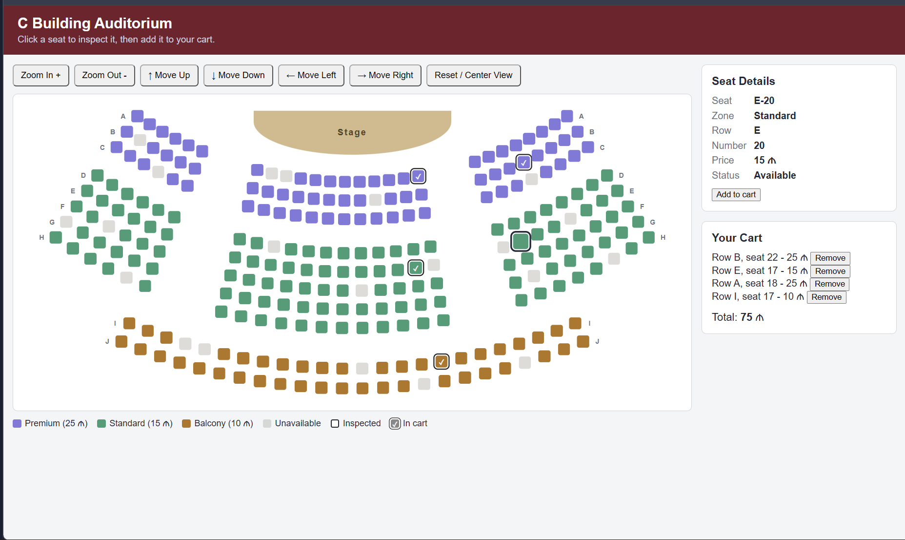
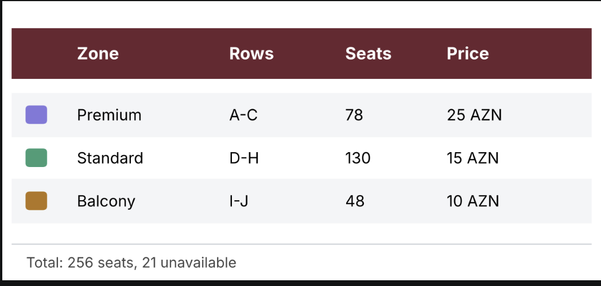

# Interactive Venue Ticketing System: C Building Auditorium

A front-end web application for seat selection, designed for the large auditorium in Building C at ADA University. Visitors can view an interactive seating map, inspect the details and price of individual seats, add seats to a cart, and come back later to find the cart restored. The project is built with plain HTML, CSS and JavaScript, with no frameworks, back end or build tools.



## Venue

The venue is modelled on the large auditorium in Building C at ADA University. The stage is at the top, and the seats are arranged in curved rows around it.



| Zone | Rows | Price |
|------|------|-------|
| Premium | A–C | 25 ₼ |
| Standard | D–H | 15 ₼ |
| Balcony | I–J | 10 ₼ |

Total: 256 seats, of which 21 are unavailable (already sold).

## Features

**Map and seats**
- The venue map is generated from JavaScript data. Seats are not hard-coded in the HTML.
- Curved rows arranged in blocks, with aisles that line up in straight lines.
- A stage, row labels at both ends of each row and a colour legend based on price categories.
- Every seat is a real `<button>`, so the map works with both mouse and keyboard.
- Clicking a seat only inspects it: the panel shows its ID, zone, row, number, price and status.
- Four seat states: available, inspected, in cart and unavailable. Each one looks different on the map and in the legend.

**Map controls**
- Zoom in and zoom out with limits.
- Move up, down, left and right. Movement is limited so the map cannot leave the viewport.
- Reset / Center view fits the whole map into the viewport and centres it.

**Cart**
- The Add to cart button adds the inspected seat. The cart lists the seats with prices and a total.
- Each cart item can be removed. The map and the cart always stay in sync.
- A seat cannot be added twice, and an unavailable seat cannot be added at all.
- The cart is saved in `localStorage` and restored after a page reload, together with the seat states on the map.

**Layout and accessibility**
- Responsive layout: the side panel moves below the map on narrow screens, the controls wrap, and the map fits the screen width.
- Each seat has a descriptive `aria-label`, and the inspected seat has `aria-current`.

## Bonus

- Mouse wheel zoom, centred on the cursor.
- Click and drag to pan the map. A short click still inspects a seat, and a drag does not.

## Getting started

No installation is needed. Clone the repository and open `index.html` in a modern browser, or serve the folder with a local server such as the VS Code "Live Server" extension.

```bash
git clone https://github.com/orkhannabiyev1/Orkhan-Nabiyev-venue-ticketing-c-building.git
```

## Project structure

| File | Purpose |
|------|---------|
| `index.html` | Page structure: map area, seat details, cart |
| `css/style.css` | Layout, seat states, legend, stage, responsive rules |
| `js/venue-data.js` | Venue model: zones, rows, prices, unavailable seats |
| `js/app.js` | Seat generation, rendering, map view, cart and storage |

## How it works

**Data model.** The `VENUE` object lives in `js/venue-data.js`. Price categories (label, price, colour) are defined once and zones refer to them by name, so a price change updates the map, the legend and the seat details. Each zone defines its rows by radius, seats per block (for example `[6, 12, 8]`), angle step and aisle gap. Unavailable seats are stored as a list of seat IDs such as `"A-8"`.

**Seat generation.** Rows are arcs around a common centre point. `getSeatPosition` uses `Math.sin` and `Math.cos` to turn a radius and an angle into `x` and `y` coordinates. `buildSeats` loops over zones, rows, blocks and seats and creates one object per seat with its ID, price, colour, position and status. `renderSeats` then creates a `<button>` for each seat.

**Map view.** The zoom and position of the map are kept in one `view` object (`scale`, `x`, `y`). `applyView` limits the position and writes it to the CSS `transform`. Zoom buttons, move buttons, Reset, wheel zoom and drag all change `view` and call `applyView`.

**Cart and storage.** The cart is an array of seat IDs. The price, row and number are looked up from the seat data, and the in-cart look of a seat on the map is derived from the cart. After every change the array is saved to `localStorage`. When the page loads, the saved IDs are checked (the seat must exist, must not be unavailable and must not be a duplicate) before they are restored.

## Known limitations

- There is no checkout or payment: the cart only collects the chosen seats.
- The cart is stored in the browser, so it is not shared between browsers or devices.